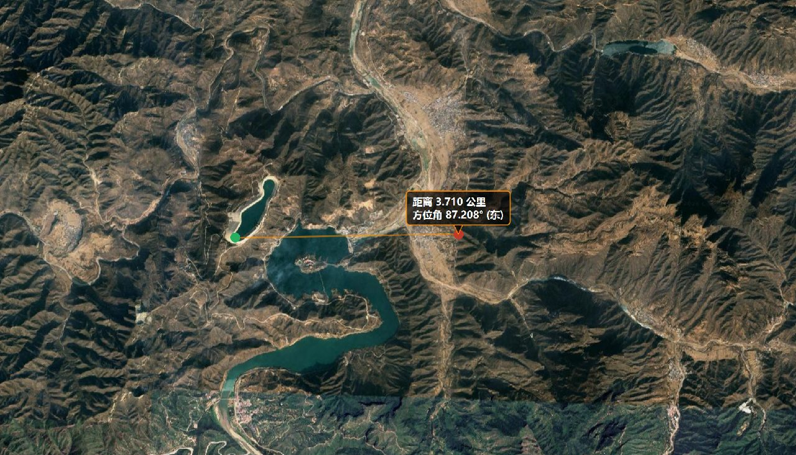
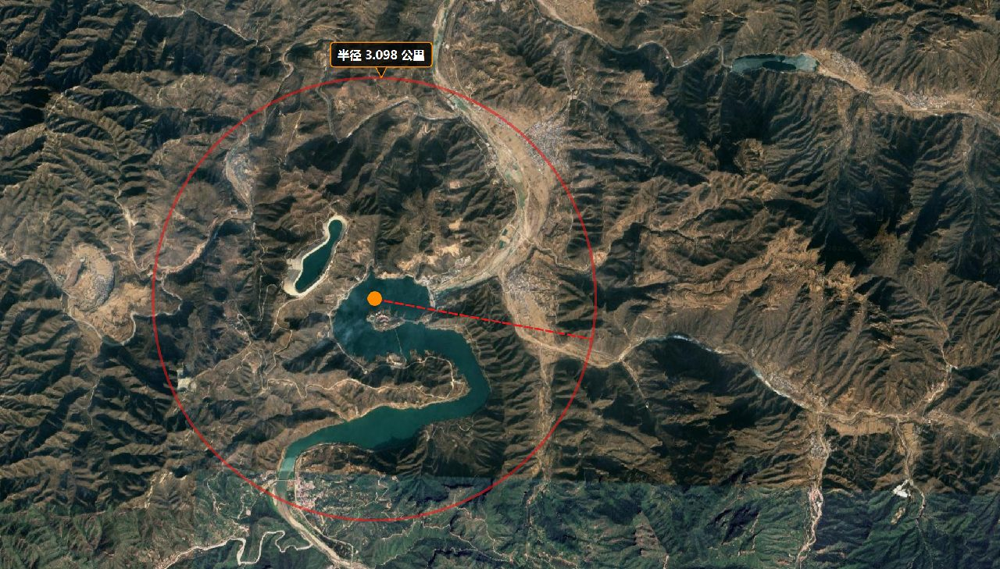
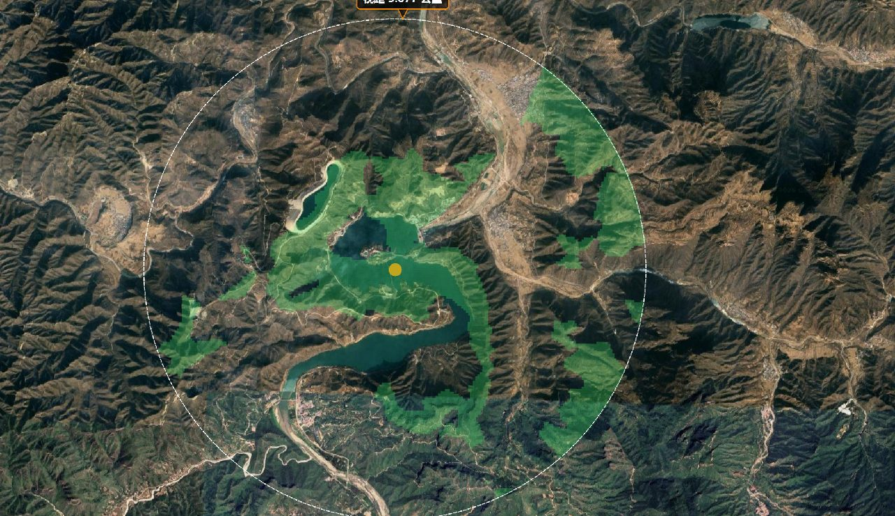

# 测量工具箱

一个轻量的 QGIS 插件，提供三个地图工具：

| 工具 | 用途 |
|---|---|
| **两点测距与方位角** | 点两下，距离和方位角标在线条终点 |
| **范围圈（半径）** | 点圆心，拖出等距圆 |
| **视域分析（可见范围）** | 点观察点 + 拖视距，用 DEM 算能看到哪些地方 |

## 功能

### 工具一：两点测距与方位角

- 地图上依次点击 A、B 两点，测量 A→B 距离
- 计算 A→B 的**起点方位角**（真北 0°，顺时针 0–360°）
- 结果显示在**终点 B 的标签**上
- 取 A 点后移动鼠标可**实时预览**
- 距离按数量级自动切换 米 / 公里



### 工具二：范围圈（半径）

- 点一个圆心，移动鼠标画出**等距圆**（每个方向的地面距离都等于半径）
- 圆上标注**半径**
- 左键固定圆，再次左键可重画



### 工具三：视域分析（可见范围）

- 点一个观察点，拖出视距半径，计算**从该点能真正看到的地面范围**
- 观察点高程**自动从 DEM 读取**（不用手输）
- 结果以**均匀绿色半透明区域**覆盖在地图上（纯色填充，不画像元网格线）
- DEM 只需在**首次使用时选择一次**，之后自动记住
- 支持**本地 DEM**，也支持 **Terrarium 编码的 XYZ 在线高程**（见下节）



#### 在线高程源（Terrarium XYZ）

项目里如果有 Terrarium 编码的 XYZ 高程图层（例如「NextGIS 真实高程」：
`https://terrarium.nextgis.ru/{z}/{x}/{y}.png`，图层源里带 `type=xyz`、
`terrarium.nextgis.ru` 或 `interpretation=terrariumterrain`），视域工具会自动
走「先缓存瓦片、再计算」的路径：

1. 按视距圆算出需要的少量瓦片（3km 视距约 4 块 z12；1.2km 约 4 块 z13；小视距用 z14）
2. 下载 PNG 瓦片并按 Terrarium 公式解码成高程米数：
   `高程 = R × 256 + G + B / 256 − 32768`
3. 拼成约 30m（大视距 35m）的本地 GeoTIFF（EPSG:4326）
4. 用与本地 DEM **完全相同**的视域算法计算

缓存（默认 `D:\Temp\point_bearing_cache`，可用环境变量
`POINT_BEARING_CACHE_DIR` 覆盖，或用菜单设置里的默认目录）：

| 内容 | 位置 |
|---|---|
| 原始瓦片 | `z{z}\{x}\{y}.png`（同一瓦片只下载一次） |
| 拼好的 DEM | `dem\z{z}_x.._y.._{px}m.tif`（同一瓦片范围可复用） |
| 视域结果 | `viewshed_cache\*.npz`（同点同视距直接秒出） |

- 缓存目录**可以整个删掉**，下次自动重新下载，不影响功能
- 断网 / 服务不可达时会在超时后弹窗提示「无法连接在线高程服务…」，**不会卡死**
- 其他在线源（非 Terrarium 的 XYZ / WMS / WCS）仍按 v1.3.1 的逻辑拒绝

实测（QGIS 4.2，3km 视距，以本地 30m 的 `合并.tif` 作参照）：首次含下载约 3–6 秒，
热缓存 < 1 秒；在线结果与本地 DEM 的可见区域 **IoU≈0.9**，可见比例差 < 1 个百分点，
观察点高程差约 1m。

## 安装

1. 打开 QGIS
2. 菜单 `插件 → 管理并安装插件`
3. 点左侧「**从 ZIP 安装**」
4. 选择 `point_bearing_tool.zip`
5. 安装完成后，在「已安装」里勾选启用

装好即生效，不需要重启 QGIS。

## 使用

### 两点测距

1. 点工具栏第一个图标，或菜单 `插件 → 测量工具箱 → 两点测距与方位角`
2. 鼠标变为十字，在地图上**点 A 点**
3. **点 B 点** → 终点出现标签：

```
┌────────────────────────┐
│ 距离 1.685 公里          │
│ 方位角 143.625° (东南)   │
└───────────▽────────────┘
            ● B 点
```

### 范围圈

1. 点工具栏第二个图标（红色圆环）
2. 在地图上**点一下确定圆心**（出现橙点）
3. **移动鼠标** → 圆随光标变大/变小，实时显示半径
4. **左键再点** → 固定这个圆

```
      ┌──────────────────┐
      │ 半径 2.017 公里    │
      └────────▽─────────┘
         ╱              ╲
        │       ●───────│  ← 橙点=圆心，虚线=半径
         ╲              ╱
          └────────────┘
```

### 视域分析

**第一次使用**：点「视域分析」按钮时会弹窗让你选 DEM 图层。
也可以在菜单里点 `设置高程(DEM)图层…` 预先设置。

1. 点工具栏第三个图标（山脊 + 绿色扇面）
2. 地图上**点观察点**（出现橙点）
3. **移动鼠标**设置视距（白色虚线圆跟着变，标签显示视距）
4. **左键**开始计算 → 几秒后绿色可见区域出现
5. 右键或 Esc 退出

结果会同时提示：`可见 26.1%（约 8310/31862 像元） 地面 403m（观察高 30.0m）`

如果弹窗提示「观察点不在所选 DEM 的覆盖范围内」，对话框里会列出 DEM 范围和观察点坐标，
据此换一个覆盖该点的 DEM 即可；若提示「读不到观察点附近的有效高程」，多半是该处为
NoData 或 DEM 损坏，可在 QGIS 里用「识别要素」核对。

### 交互

| 操作 | 测距工具 | 范围圈 | 视域分析 |
|---|---|---|---|
| 左键 | 取点 A / B | 定圆心 / 固定圆 | 定观察点 / 计算 |
| 移动鼠标 | 预览距离方位 | 调整半径 | 调整视距 |
| 右键 / Esc | 结束（保留标注） | 结束（保留圆） | 结束（保留结果） |
| Delete | 清除当前 | 清除当前 | 清除当前 |
| 再点左键 | 开始新测量 | 重新定圆心 | 重算 |

## 计算说明

### 距离与方位角

- **距离**：`QgsDistanceArea.measureLine()`，基于 **WGS84 椭球面**，
  与 Vincenty 反算精确解误差 0.00 mm
- **方位角**：`QgsDistanceArea.bearing()`，大圆**初始**方位角，以真北为 0°、顺时针；
  结果归一化到 `[0, 360)`

### 范围圈

用 **Vincenty 正算**逐方位角求点，不是简单在经纬度上加半径。
因此圆上每个方向到圆心的**地面距离都精确等于**设定半径（实测偏差 < 0.001 mm）。

### 视域分析

沿观察点周围的每个方位角发一条射线，逐点比较仰角：

- 某点仰角 **≥** 射线沿途已记录的最大仰角 → **可见**（它越过了之前的遮挡）
- 否则 → **被挡**

射线之间的空隙像元会用完整视线检查补齐。支持**地球曲率修正**。

观察点高程 = DEM 在该点的值 + 观察者高度（默认 **30m**，模拟基站铁塔；
可在设置里改）。
DEM 读取范围会先对齐到像元格网，再按像元中心双线性插值，避免半像元偏移
（陡坡上这能让地面高程差好几米）。

DEM 为经纬度坐标系（如 EPSG:4326）时，会按观察点纬度把"度"换算成米，
东西/南北分别换算后再计算，不需要预先重投影。

## 可调参数

菜单 `插件设置…`（扳手图标）里有完整设置界面，两个标签页：

**视域计算**

| 参数 | 默认 | 说明 |
|---|---|---|
| 观察者高度 | 30 m | 观察点高程 = 地面 + 此值（模拟基站铁塔） |
| 目标高度 | 0 m | 被观察物体自身高度 |
| 仰角容差 | 0.02 | 越大越容易判"可见"（擦边可见）；设 0 最严格 |
| 地球曲率修正 | 开 | 3km 处约影响 0.7m |
| 计算质量 | 标准 | 快速 / 标准 / 精细（射线密度） |

**显示样式**：视域填充色与不透明度、视距辅助圆、测距连线、范围圈圆周的颜色 / 线宽 / 透明度。

所有设置存在 QgsSettings（`point_bearing_tool/*`），重装插件不丢，保存后下次计算立即生效；
对话框里的「恢复默认」一键还原。

## 依赖

仅依赖 QGIS 自带的 PyQt / qgis.core / qgis.gui，外加 QGIS 内置的 numpy 与 GDAL。
**无需额外 pip 安装。**

视域分析需要一份 DEM 高程栅格：本地 tif / 项目里的栅格，或 Terrarium 编码的
XYZ 在线高程图层。**本地 DEM 不需要网络**；在线高程需要能访问
`terrarium.nextgis.ru`（会沿用系统的 HTTPS 代理设置）。

## 兼容性

- QGIS 3.28 及以上（含 Qt5 与 Qt6 构建）
- 已在 QGIS 4.2 实测

## 许可证

GNU General Public License v2.0 或更新版本。

## 开发

```
point_bearing_tool/
├── __init__.py        # QGIS 入口 classFactory
├── plugin.py          # 主类：菜单、工具栏、DEM 选择
├── map_tool.py        # 测距工具
├── radius_tool.py     # 范围圈工具
├── viewshed_tool.py   # 视域工具（交互 + 渲染 + 结果缓存）
├── viewshed.py        # 视域算法（射线追踪，可独立测试）
├── online_dem.py      # 在线高程：Terrarium XYZ 瓦片下载/解码/拼 GeoTIFF/缓存
├── settings_dialog.py # 「插件设置…」对话框（视域参数 + 显示样式）
├── label_item.py      # 画布文字标签（QgsMapCanvasItem）
├── geodesy.py         # 距离/方位角/等距圆计算（可独立测试）
├── settings.py        # 设置持久化
├── metadata.txt
├── icon.svg           # 测距图标
├── icon_radius.svg    # 范围圈图标
├── icon_viewshed.svg  # 视域图标
├── icon_settings.svg  # 设置图标（扳手）
├── README.md
└── LICENSE
```
